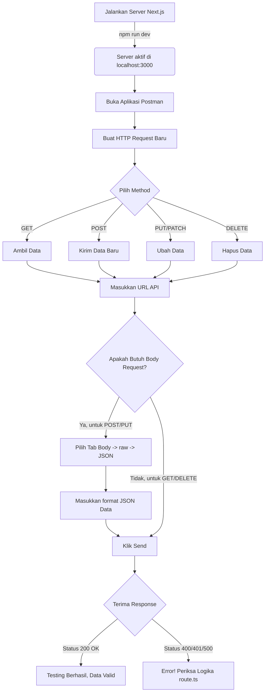

# Panduan Arsitektur & Pengujian API AkademiData

Dokumen ini menjelaskan bagaimana arsitektur API dibangun di dalam platform AkademiData menggunakan **Next.js App Router (Route Handlers)** dan bagaimana cara melakukan pengujian (testing) menggunakan **Postman**.

---

## 1. Arsitektur API di Next.js

Karena AkademiData dibangun menggunakan Next.js App Router, seluruh *backend logic* dan *endpoint API* disatukan dalam satu *codebase* dengan frontend.

Aturan pembuatan endpoint API:
- Semua endpoint API diletakkan di dalam folder `src/app/api/`.
- Setiap endpoint merupakan folder, dan logika fungsinya ditulis di dalam file wajib bernama `route.ts`.
- Fungsi yang diekspor menggunakan nama *HTTP Method* (`GET`, `POST`, `PUT`, `DELETE`).

### Contoh Struktur Folder:
```text
src/
└── app/
    └── api/
        ├── auth/
        │   └── login/
        │       └── route.ts     --> Endpoint: POST /api/auth/login
        ├── siswa/
        │   └── route.ts         --> Endpoint: GET /api/siswa (List), POST /api/siswa (Create)
        └── soal/
            └── [id]/
                └── route.ts     --> Endpoint: GET /api/soal/:id (Detail Soal)
```

---

## 2. Alur Pengujian menggunakan Postman

Postman digunakan untuk memastikan bahwa API (Backend) yang dibuat merespons dengan data yang benar sebelum diintegrasikan dengan tampilan (Frontend).



### Langkah-langkah Detail Pengujian (Contoh: API Login)

1. **Pastikan Server Lokal Berjalan**:
   Jalankan `npm run dev` pada terminal proyek Anda. API akan dapat diakses pada `http://localhost:3000`.

2. **Pengaturan Request di Postman**:
   - Ubah method request menjadi **POST**.
   - Masukkan URL: `http://localhost:3000/api/auth/login`

3. **Pengaturan Data Body**:
   - Pilih tab **Body** di bawah URL bar.
   - Pilih opsi **raw** dan ubah format text (dari dropdown kanan) menjadi **JSON**.
   - Masukkan payload JSON berikut:
     ```json
     {
         "email": "admin@institusi.sch.id",
         "password": "admin123"
     }
     ```

4. **Eksekusi dan Evaluasi**:
   - Klik tombol biru **Send**.
   - Analisis hasil di kotak **Response** (bawah).
   - Pastikan Anda menerima *HTTP Status Code* **200 OK** dan *response JSON* yang sesuai dari server, misalnya:
     ```json
     {
         "message": "Login berhasil",
         "user": {
             "role": "admin",
             "email": "admin@institusi.sch.id"
         }
     }
     ```
   - Jika Anda mencoba email yang salah, pastikan API mengembalikan error yang tepat (misal: *401 Unauthorized*).
