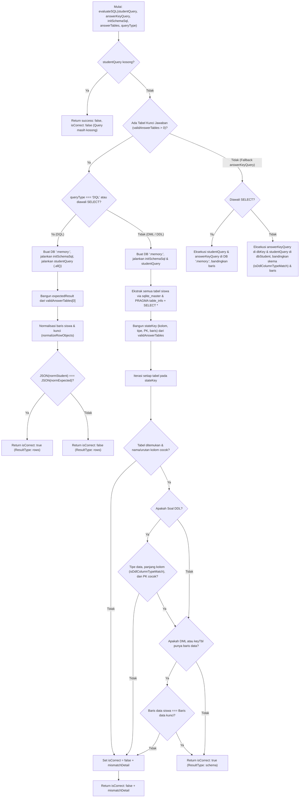

# Product Requirements Document (PRD) & Dokumentasi Algoritma: Mesin Evaluasi SQL Otomatis (`sql-grader.ts`)

## 1. Ikhtisar (Overview)
- **Nama Modul**: Mesin Evaluasi SQL Otomatis (*SQL Auto-Grader Engine*)
- **Lokasi File**: `src/lib/sql-grader.ts`
- **Endpoint Pemanggil**: `POST /api/latihan-soal/evaluate` (`src/app/api/latihan-soal/evaluate/route.ts`)
- **Teknologi Inti**: `better-sqlite3` (*In-Memory SQLite Database Sandbox* — `:memory:`)
- **Tujuan**:
  1. Mengeksekusi query SQL milik siswa secara terisolasi di dalam memori (`:memory:`) tanpa memengaruhi database utama aplikasi (MongoDB) maupun sesi siswa lainnya.
  2. Menilai kebenaran jawaban SQL siswa secara otomatis berdasarkan **hasil eksekusi aktual** (*Result Set* atau *Database Schema & State*), bukan sekadar pencocokan teks biasa (*string matching*), sehingga variasi penulisan spasi, huruf besar/kecil, atau urutan klausa yang ekuivalen tetap dinilai secara adil dan akurat.
  3. Mendukung evaluasi tiga kategori perintah SQL: **DQL (`SELECT`)**, **DML (`INSERT`, `UPDATE`, `DELETE`)**, dan **DDL (`CREATE`, `ALTER`, `DROP`)**, baik menggunakan **Tabel Kunci Jawaban (`answerTables`)** maupun **Query Kunci Jawaban (`answerKeyQuery`)**.

---

## 2. Spesifikasi Kebutuhan Fungsional (Functional Requirements)

| ID | Kebutuhan Fungsional | Deskripsi |
| :--- | :--- | :--- |
| **FR-01** | **Validasi Input Kosong** | Jika `studentQuery` kosong atau hanya berisi spasi, sistem langsung mengembalikan `success: false` dan `isCorrect: false` tanpa membuat koneksi sandbox. |
| **FR-02** | **Isolasi Sandbox In-Memory** | Setiap evaluasi membuat instance `new Database(':memory:')` baru, mengeksekusi skema awal (`initSchemaSql`), menjalankan query siswa, mengambil hasil/metadata, lalu menutup koneksi (`db.close()`). |
| **FR-03** | **Evaluasi DQL (`SELECT`)** | Mengeksekusi query `SELECT` siswa dan membandingkan *Result Set* (nama kolom dan isi baris yang telah dinormalisasi) terhadap *Result Set* dari Tabel Kunci Jawaban (`answerTables`) atau eksekusi `answerKeyQuery`. |
| **FR-04** | **Evaluasi DML (`INSERT`, `UPDATE`, `DELETE`)** | Mengeksekusi query manipulasi data siswa di atas `initSchemaSql`, lalu memeriksa kondisi akhir tabel (`SELECT * FROM <tabel>`) dan membandingkan nama kolom serta seluruh baris data terhadap kondisi akhir yang diharapkan. |
| **FR-05** | **Evaluasi DDL (`CREATE`, `ALTER`, `DROP`)** | Mengeksekusi query definisi struktur tabel siswa, membaca metadata skema menggunakan `PRAGMA table_info(<nama_tabel>)`, dan memvalidasi: (1) keberadaan tabel, (2) nama & urutan kolom, (3) tipe data & panjang karakter (`VARCHAR(100)` vs `VARCHAR(50)`, `INT`), serta (4) constraint `PRIMARY KEY`. |
| **FR-06** | **Normalisasi Data & Tipe** | Menyamakan format nama kolom menjadi *lowercase*, nilai kosong/`null`/`undefined` menjadi `'NULL'`, memangkas spasi berlebih (`trim()`), dan menormalisasi ekuivalensi tipe `INTEGER` ↔ `INT` serta `INT` ↔ `INT(11)`. |
| **FR-07** | **Penanganan Error Sintaks SQL** | Jika query siswa mengandung kesalahan sintaks SQL atau melanggar *constraint* database (misal tabel tidak ditemukan, duplikasi Primary Key), blok `try-catch` menangkap pesan error dari SQLite dan mengembalikannya secara informatif ke terminal siswa. |

---

## 3. Struktur Input & Output (`evaluateSQL`)

### 3.1. Parameter Input
```typescript
evaluateSQL(
  studentQuery: string,        // Query SQL yang ditulis oleh siswa
  answerKeyQuery: string = '', // Query SQL kunci jawaban (fallback / preview)
  initSchemaSql: string = '',  // DDL + DML awal untuk membangun kondisi awal sandbox
  answerTables: any[] = [],    // Struktur & baris Tabel Kunci Jawaban dari Visual Builder Guru
  queryType: string = 'DQL'    // Kategori soal: 'DQL' | 'DML' | 'DDL'
)
```

### 3.2. Struktur Output
```typescript
{
  success: boolean;            // true jika query berhasil dieksekusi tanpa syntax/runtime error
  isCorrect: boolean;          // true jika hasil query siswa sesuai dengan kunci jawaban
  resultType?: 'rows' | 'schema'; // 'rows' untuk DQL (SELECT), 'schema' untuk DML & DDL
  executionTimeMs: number;     // Durasi eksekusi dalam milidetik (ms)
  expectedResult?: any;        // Data baris atau struktur tabel kunci jawaban
  studentResult?: any;         // Data baris atau struktur tabel hasil query siswa
  message: string;             // Pesan umpan balik spesifik (benar / letak ketidakcocokan / pesan error)
}
```

---

## 4. Rincian Fungsi Pembantu (Helper Functions)

### 4.1. `normalizeRowObjects(rows)`
Digunakan untuk menormalisasi array objek baris hasil query agar perbandingan tidak gagal hanya karena perbedaan tipe primitif (angka `10` vs string `'10'`) atau huruf kapital nama kolom:
1. Melakukan iterasi pada setiap objek baris (`row`).
2. Mengubah setiap *key* (nama kolom) menjadi `k.trim().toLowerCase()`.
3. Mengubah nilai `null`, `undefined`, atau `''` menjadi string `'NULL'`, dan nilai lainnya menjadi `String(val).trim()`.

### 4.2. `parseSqlType(rawType)`
Memecah string tipe data SQL menjadi tipe dasar (`baseType`) dan panjang karakter (`length`) menggunakan Regular Expression `/^([A-Z0-9_]+)\s*(?:\(\s*([^)]+)\s*\))?/`:
- Contoh `"VARCHAR(100)"` $\rightarrow$ `{ baseType: "VARCHAR", length: "100" }`
- Contoh `"VARCHAR"` $\rightarrow$ `{ baseType: "VARCHAR", length: "" }`
- Contoh `"INTEGER"` atau `"INT(11)"` $\rightarrow$ `baseType` dinormalisasi menjadi `"INT"`.

### 4.3. `isDdlColumnTypeMatch(studentType, keyType)`
Memvalidasi kecocokan tipe data kolom siswa terhadap kunci jawaban pada soal DDL:
1. Memanggil `parseSqlType` untuk tipe kolom siswa (`st`) dan kunci jawaban (`key`).
2. Jika `st.baseType !== key.baseType` (misal `INT` vs `VARCHAR`), langsung mengembalikan `false`.
3. **Aturan Khusus `INT`**: Karena Visual Builder secara default mengisi panjang `11` pada tipe `INT` walaupun soal hanya meminta `INT`, maka jika `key.baseType === 'INT'` dan `key.length` kosong atau `'11'`, baik `INT` (`st.length === ''`) maupun `INT(11)` (`st.length === '11'`) dianggap **Valid (`true`)**.
4. **Aturan Ketat Tipe Berpanjang (`VARCHAR`, `CHAR`, dll.)**: Jika kunci jawaban memiliki `key.length` (misal `VARCHAR(100)` atau `VARCHAR(50)`), maka `st.length` **wajib sama persis** (`st.length === key.length`). Jika siswa hanya menulis `VARCHAR` tanpa `(50)`, maka dikembalikan `false`.

### 4.4. `buildExpectedRowsFromTable(ansTable)`
Mengonversi struktur `answerTables` dari Visual Table Builder Guru (yang menyimpan nilai baris berdasarkan `column.id`) menjadi array objek baris standar `{ [nama_kolom]: nilai }`.

---

## 5. Algoritma Utama Evaluasi (`evaluateSQL`)

### 5.1. Diagram Alir Algoritma (Flowchart)



---

### 5.2. Langkah-Langkah Algoritma (*Step-by-Step Pseudocode*)

```text
ALGORITMA EvaluateSQL
INPUT: studentQuery, answerKeyQuery, initSchemaSql, answerTables, queryType
OUTPUT: Objek Hasil Evaluasi (success, isCorrect, resultType, executionTimeMs, expectedResult, studentResult, message)

1. Catat waktu mulai: startTime = Date.now()
2. JIKA studentQuery kosong ATAU hanya berisi whitespace MAKA
     KEMBALIKAN { success: false, isCorrect: false, message: "Query SQL masih kosong..." }
3. Filter answerTables yang memiliki nama tabel atau kolom valid -> validAnswerTables
4. Cek apakah studentQuery diawali kata "SELECT" (case-insensitive) -> isSelectStudent

5. CABANG 1: JIKA validAnswerTables TIDAK KOSONG MAKA
   5.1. SUB-CABANG A (Evaluasi DQL / SELECT):
        JIKA queryType == 'DQL' ATAU isSelectStudent == true MAKA
          a. Buat database SQLite in-memory: db = new Database(':memory:')
          b. JIKA initSchemaSql tidak kosong, jalankan db.exec(initSchemaSql)
          c. Jalankan studentResult = db.prepare(studentQuery).all()
          d. Tutup koneksi db.close()
          e. Bangun expectedResult = buildExpectedRowsFromTable(validAnswerTables[0])
          f. Normalisasi kedua hasil:
             normStudent  = normalizeRowObjects(studentResult)
             normExpected = normalizeRowObjects(expectedResult)
          g. Bandingkan: isCorrect = (JSON.stringify(normExpected) === JSON.stringify(normStudent))
          h. KEMBALIKAN hasil evaluasi bertipe 'rows' beserta pesan status.

   5.2. SUB-CABANG B (Evaluasi DML / DDL):
        SELAIN ITU (bukan SELECT):
          a. Buat database SQLite in-memory: dbStudent = new Database(':memory:')
          b. JIKA initSchemaSql tidak kosong, jalankan dbStudent.exec(initSchemaSql)
          c. Jalankan perintah siswa: dbStudent.exec(studentQuery)
          d. Ambil daftar seluruh tabel non-sistem dari sqlite_master
          e. UNTUK SETIAP tabel pada dbStudent:
             - Ambil metadata kolom via PRAGMA table_info(nama_tabel):
               simpan { name (lowercase), type (uppercase), pk (boolean) }
             - Ambil seluruh baris data via SELECT * FROM nama_tabel
             - Simpan ke dalam peta stateStudent[nama_tabel]
          f. Tutup koneksi dbStudent.close()
          g. Bangun peta stateKey dari validAnswerTables:
             - Susun definisi kolom { name (lowercase), type (beserta length), pk (boolean) }
             - Susun baris data yang diharapkan via buildExpectedRowsFromTable(tbl)
          h. Inisialisasi isCorrect = true, mismatchDetail = ''
          i. UNTUK SETIAP nama tabel tName di dalam stateKey:
             i.1. JIKA stateStudent[tName] tidak ada MAKA
                  isCorrect = false; mismatchDetail = "Tabel belum ditemukan"; HENTIKAN LOOP
             i.2. Bandingkan daftar nama kolom:
                  JIKA nama/urutan kolom stateStudent[tName] != stateKey[tName] MAKA
                  isCorrect = false; mismatchDetail = "Nama atau urutan kolom belum sesuai"; HENTIKAN LOOP
             i.3. Deteksi apakah soal merupakan DDL (queryType == 'DDL' atau query diawali CREATE/ALTER/DROP):
                  JIKA DDL MAKA
                    UNTUK SETIAP kolom ke-i pada stateKey[tName]:
                      - Periksa tipe & panjang kolom menggunakan isDdlColumnTypeMatch(stCol.type, keyCol.type)
                        JIKA tidak cocok MAKA
                          isCorrect = false
                          mismatchDetail = "Tipe data kolom tidak sesuai dengan kunci jawaban"
                          HENTIKAN LOOP
                      - Periksa constraint PRIMARY KEY (Boolean(stCol.pk) === Boolean(keyCol.pk))
                        JIKA tidak cocok MAKA
                          isCorrect = false
                          mismatchDetail = "Ketidakcocokan PRIMARY KEY pada kolom"
                          HENTIKAN LOOP
             i.4. JIKA queryType == 'DML' ATAU stateKey[tName] memiliki baris data MAKA
                  Bandingkan normalizeRowObjects(stTbl.rows) dengan normalizeRowObjects(keyTbl.rows)
                  JIKA tidak sama MAKA
                    isCorrect = false; mismatchDetail = "Isi baris data belum sesuai"; HENTIKAN LOOP
          j. KEMBALIKAN hasil evaluasi bertipe 'schema' beserta mismatchDetail jika salah.

6. CABANG 2: JIKA validAnswerTables KOSONG (Fallback menggunakan answerKeyQuery) MAKA
   6.1. JIKA isSelectStudent == true MAKA
        Jalankan studentQuery dan answerKeyQuery pada DB ':memory:', lalu bandingkan normalizeRowObjects keduanya.
   6.2. SELAIN ITU (DML/DDL Fallback):
        a. Jalankan initSchemaSql + answerKeyQuery pada dbKey (':memory:') -> ekstrak stateKey
        b. Jalankan initSchemaSql + studentQuery pada dbStudent (':memory:') -> ekstrak stateStudent
        c. Bandingkan setiap tabel, nama kolom, tipe kolom (isDdlColumnTypeMatch), PK, dan isi baris antara stateKey dan stateStudent.
        d. KEMBALIKAN hasil evaluasi bertipe 'schema'.

7. PENANGANAN EXCEPTION (CATCH ERROR):
   JIKA terjadi error saat eksekusi SQLite (misal syntax error, table already exists, no such column) MAKA
     KEMBALIKAN { success: false, isCorrect: false, message: "Error Database: " + error.message }
```

---

## 6. Matriks Skenario Pengujian (Test Cases)

| No | Tipe Soal | Kunci Jawaban | Query Siswa | Hasil (`isCorrect`) | Alasan / Validasi Algoritma |
| :-: | :---: | :--- | :--- | :---: | :--- |
| 1 | **DDL** | `dosen (nidn INT(11) PK, nama_dosen VARCHAR(100), bidang_keahlian VARCHAR(50))` | `CREATE TABLE dosen (nidn INT PRIMARY KEY, nama_dosen VARCHAR(100), bidang_keahlian VARCHAR(50))` | **Benar (`true`)** | `INT` kompatibel dengan default `INT(11)`, `PK` cocok, serta `VARCHAR(100)` dan `VARCHAR(50)` identik. |
| 2 | **DDL** | `dosen (nidn INT(11) PK, nama_dosen VARCHAR(100), bidang_keahlian VARCHAR(50))` | `CREATE TABLE dosen (nidn INT PRIMARY KEY, nama_dosen INT, bidang_keahlian VARCHAR)` | **Salah (`false`)** | `nama_dosen` bertipe `INT` (bukan `VARCHAR(100)`) dan `bidang_keahlian` tidak mencantumkan panjang `(50)`. |
| 3 | **DDL** | `dosen (nidn INT(11) PK, ...)` | `CREATE TABLE dosen (nidn INT, nama_dosen VARCHAR(100), bidang_keahlian VARCHAR(50))` | **Salah (`false`)** | Kolom `nidn` tidak diberi constraint `PRIMARY KEY` (`stCol.pk !== keyCol.pk`). |
| 4 | **DML** | Tabel `produk` berisi 3 baris setelah `INSERT` | `INSERT INTO produk VALUES (3, 'Mouse Wireless', 150000);` | **Benar (`true`)** | Isi baris akhir tabel `produk` di sandbox siswa sama persis dengan baris pada `answerTables`. |
| 5 | **DQL** | Hasil `SELECT nama, jurusan, ipk` untuk `'Informatika'` (2 baris) | `SELECT nama, jurusan, ipk FROM mahasiswa WHERE jurusan = 'Informatika'` | **Benar (`true`)** | *Result Set* (kolom dan nilai baris setelah dinormalisasi) identik. |
